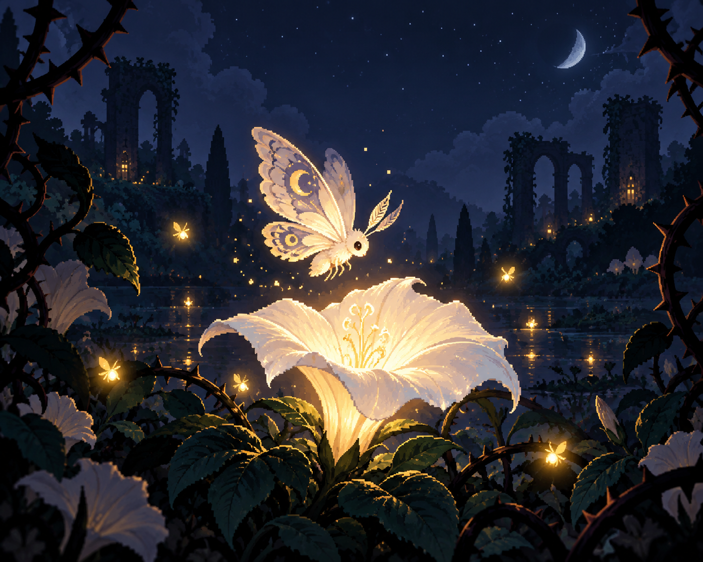

# Mothlight: Last Bloom

**A short, original 2D arcade game about a little moth, a fading moonflower, and one last moonlit night.** Gather fireflies, carry their light back to the bloom, and send thorn spirits scattering with a pulse.

[Play and download on itch.io](https://aniket-a14.itch.io/mothlight-last-bloom) · [GitHub preview release](https://github.com/Aniket-a14/mothlight-last-bloom/releases/tag/v0.1.0-preview)

> **Preview build:** macOS is not Developer ID signed or notarized, and Windows has not yet been tested on a Windows computer. Review the platform notes under [Download](#download) before downloading.

## The game

Mothlight is a bite-sized, three-minute top-down arcade game. Sweep through a small twilight garden and gather drifting fireflies with a soft hum. Bring them to the moonflower to wake its three petals. Release your gathered light elsewhere to repel the thorn spirits closing in.

### Controls

| Action | Controls |
| --- | --- |
| Move | `WASD` or arrow keys |
| Gather nearby fireflies | Hold `Space` or left mouse button |
| Release gathered light | Release near the flower to feed it; elsewhere to repel spirits |
| Pause | `Esc` |
| Restart | `R` |

Wake all three petals before the night ends. Three thorn hits end the run.

## Download

Get the current preview from [itch.io](https://aniket-a14.itch.io/mothlight-last-bloom) or the [GitHub release page](https://github.com/Aniket-a14/mothlight-last-bloom/releases/tag/v0.1.0-preview).

| Platform | Package | Current status |
| --- | --- | --- |
| macOS | Universal Apple silicon + Intel ZIP | App launches on the development Mac. Ad-hoc signed and not notarized; Gatekeeper may block it. |
| Windows | x64 ZIP | Build and archive were verified; launching and gameplay have not been tested on Windows. |

Extract the Windows ZIP, then run `Mothlight.exe` from the extracted folder. On macOS, extract the ZIP and open `Mothlight.app`; macOS may show a security warning because this preview is not notarized. Only proceed if you trust the source and are comfortable with that warning. A Developer ID signed and notarized Mac build is not available yet.

## About the project

- **Engine:** Unity 6 (`6000.3.26f1`)
- **Style:** original storybook-like pixel art drawn procedurally in the game
- **Audio:** original ambient music and effects synthesized at runtime
- **Platforms:** macOS universal and Windows x64 preview builds
- **Networking:** none

The game visuals are drawn by the project code and the audio is synthesized in-game. The separate itch.io cover image is AI-generated. See [asset provenance](ASSET_PROVENANCE.md) for details and [project status](STATUS.md) for build, test, and playtest evidence.

## Build from source

1. Install Unity `6000.3.26f1`.
2. Open this repository folder as a Unity project.
3. Open the included scene and use Unity Build Profiles to build for your platform.

The standalone `.app` and platform build outputs are not stored in the source tree; use the preview packages linked above. Unity Edit Mode test results and current verification notes are recorded in [`STATUS.md`](STATUS.md) and [`test-results.xml`](test-results.xml).

## Feedback

Found a bug or have a suggestion? Open an [issue](https://github.com/Aniket-a14/mothlight-last-bloom/issues).

## License

This repository does not currently include a license. The source is publicly viewable; reuse and redistribution terms have not been specified.
